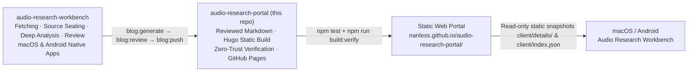

# Audio Research Portal

[简体中文](README.md) | English

> An open-source Chinese deep-reading portal and read-only client data host for speech, music, and acoustic AI researchers, powered by **[Audio Research Workbench](https://github.com/nanless/audio-research-workbench)**.

**Live Portal**: <https://nanless.github.io/audio-research-portal/>  
**Native Apps (macOS / Android)**: [GitHub Releases](https://github.com/nanless/audio-research-workbench/releases) · **Engine & Client Repo**: [nanless/audio-research-workbench](https://github.com/nanless/audio-research-workbench)

---

## Quick Links

| Surface | Live URL | Description |
|---|---|---|
| Daily Audio Digest | <https://nanless.github.io/audio-research-portal/> | Daily curated & source-sealed arXiv / HuggingFace speech, music & acoustic AI papers |
| 8 SOTA Research Hubs | <https://nanless.github.io/audio-research-portal/hubs/> | ASR, TTS, Speech Enhancement, Audio LLM & Codec, Music/MIR, Spatial Audio, Audio Understanding, Voice Conversion |
| Paper Library & Export | <https://nanless.github.io/audio-research-portal/papers/> | 9-facet hierarchical filtering, identity deduplication, Markdown / CSV / BibTeX / RIS export |
| Conference Proceedings | <https://nanless.github.io/audio-research-portal/conferences/> | Verified official dates & CCF 7th-edition metadata across top audio & AI venues |
| 9-Facet Research Directions | <https://nanless.github.io/audio-research-portal/tags/> | 400-concept controlled vocabulary hierarchy |
| Archives & Search | [Archives](https://nanless.github.io/audio-research-portal/archives/) · [Search](https://nanless.github.io/audio-research-portal/search/) | Monthly daily archive & fuzzy search (press `⌘K` / `/` anywhere on site) |
| Reader & Tooling Guides | [About](https://nanless.github.io/audio-research-portal/about/) · [Resources](https://nanless.github.io/audio-research-portal/links/) | Paper selection workflow, source verification, citation export, and AI agent collaboration |
| Native Desktop & Mobile Apps | [macOS / Android Releases](https://github.com/nanless/audio-research-workbench/releases) | Offline sync against the portal's verified content-addressed snapshots |

---

## Live Scale & Coverage (as of 2026-11-27)

- **9,402 published posts** spanning **8,673+ deduplicated verified papers**, daily research editions, and conference roundups.
- **8 Audio SOTA Research Hubs** (`/hubs/`): precomputed leaderboards (Top 20 high-scored, latest 15, open-source & demo picks), co-occurring methods/benchmarks, 6-month trends, and venue breakdowns across **15 headline venues** (`arXiv`, `ICASSP`, `Interspeech`, `NeurIPS`, `ICLR`, `ICML`, `ACL`, `EMNLP`, `ISMIR`, `DCASE`, `WASPAA`, `ASRU`, `SLT`, `CVPR`, `AAAI`).
- **19 verified conference editions** in `data/conference-directory.json` with official dates and CCF 7th-edition metadata, backed by **6-surface, 58-key canonical conference venue display parity** across the portal templates (`single.html`), library frontend (`paper-library.js`), build corpus (`research-corpus.js`), and the three client surfaces in `audio-research-workbench` (macOS native Swift, macOS WebView JS `website-browser.js`, and Android Kotlin).
- **400-concept 9-facet controlled taxonomy** (`task`, `method`, `setting`, `signal`, `application`, `research_focus`, `artifact`, `scientific_topic`, `model_family`) with immutable SHA-256 historical snapshots.
- **Main RSS + 6 curated feeds + 3-path Daily Podcast support**: full daily feed (`index.xml`), 6 curated single-paper feeds (`feeds/*.xml`), plus synchronized podcast publishing (`feeds/podcast.xml`, `data/podcast-episodes.json`, and `client/podcast/feed.json`).

---

## Two-Repository Architecture

The platform separates content generation & native app development from static site hosting & zero-trust verification:



| Aspect | `nanless/audio-research-portal` (this repo) | `nanless/audio-research-workbench` |
|---|---|---|
| Responsibilities | Reviewed Markdown storage, Hugo site build, static client data exports, zero-trust build verification, GitHub Pages deployment | Paper fetching, official HTML/PDF source sealing, LLM analysis & scoring, independent publish review, podcast production, and macOS/Android native apps |
| Execution model | 100% static & offline verifiable; zero LLM calls or external scraping | Controlled proxied fetching, multi-stage analysis, and verified publish credentials |
| Legacy path handling | Preserves historical Markdown bytes verbatim; legacy `/audio-paper-digest-blog/` internal links are normalized to `/audio-research-portal/` at build/render time | Pushes exact reviewed diffs to `main` |

---

## Reading Experience (Studio Monograph 2.0)

- **Studio Monograph 2.0 layout**: Light/dark theme toggle (synced with Giscus comments), site-wide reading progress bar, audio & reproducibility quick-spec cards, direct audio demo buttons, 8-dimension type-aware scoring signal sidebar, and floating mobile TOC.
- **Command Palette (`⌘K` / `/`)**: Instant faceted search across papers, high-score (`≥8.0`), open-source code, online demo, daily editions, and conferences; gated via `data-cmdk-pagefind-ready` emitted by `scripts/build-pagefind.js` so builds without Pagefind degrade cleanly with zero 404 requests.
- **Interactive Figure Viewer & Table Workbench**: Click any paper figure for 1×–6× zoom, pan, and light/dark inversion; sort experimental tables numerically with unit awareness, sticky first columns, and fullscreen expansion.
- **Compile-Time KaTeX Rendering-Layer Tolerance**: Zero external MathJax or jsdelivr CDN dependencies; `render_katex_formula.html` applies two-stage rendering-layer healing for legacy LaTeX/LaTeXML expressions within a strict MathML allowlist, enforcing zero `math-fallback` on all posts since 2026-11-26.
- **Precomputed Cross-Paper Knowledge Graph**: Generates `data/related-graph.json` from verified 9-facet concepts to power explained related-paper recommendations while isolating withheld classifications and zero-norm items.
- **Citations, Notes & Daily Podcasts**: One-click verified citation / BibTeX / Obsidian YAML note copy, Citation JSON / BibTeX / RIS / Markdown bundle downloads, and a built-in 0.75×–2.0× daily podcast player with chapter timestamps when episodes are published.

---

## RSS & Podcast Feeds

| Feed | Path | Coverage |
|---|---|---|
| Main Daily Digest | [`index.xml`](https://nanless.github.io/audio-research-portal/index.xml) | Latest 50 daily audio research editions |
| High-Score Picks (`≥8.0`) | [`feeds/high-score.xml`](https://nanless.github.io/audio-research-portal/feeds/high-score.xml) | Top-scored individual paper analyses |
| ASR Topic | [`feeds/topic-asr.xml`](https://nanless.github.io/audio-research-portal/feeds/topic-asr.xml) | ASR, audio-visual ASR, multi-talker & streaming recognition |
| TTS Topic | [`feeds/topic-tts.xml`](https://nanless.github.io/audio-research-portal/feeds/topic-tts.xml) | TTS, zero-shot voice cloning, prosody control & dialogue |
| Speech Enhancement Topic | [`feeds/topic-enhancement.xml`](https://nanless.github.io/audio-research-portal/feeds/topic-enhancement.xml) | Denoising, dereverberation, AEC, separation & restoration |
| Music & MIR Topic | [`feeds/topic-music.xml`](https://nanless.github.io/audio-research-portal/feeds/topic-music.xml) | Music generation, singing synthesis, MIR & stem separation |
| Audio LLM Topic | [`feeds/topic-audio-llm.xml`](https://nanless.github.io/audio-research-portal/feeds/topic-audio-llm.xml) | Audio/Speech LLMs, full-duplex dialogue & neural codecs |
| Daily Podcast (on demand) | `feeds/podcast.xml` · `client/podcast/feed.json` | Published via 3-path sync alongside the in-page daily podcast player |

---

## Read-Only Client Data & Portal Public Contracts

The first four client-facing contracts below are generated during `npm run build`, registered with schema fingerprints in [`data/paperdigest-protocols.json`](data/paperdigest-protocols.json), and verified byte-for-byte during `npm run verify` for macOS/Android offline sync; the podcast client feed is synced on demand during podcast publication, and the cross-paper graph is a portal-side public artifact verified by `npm run verify`:

| Artifact Path | Contract / Purpose & Lifecycle |
|---|---|
| `client/index.json` (plus legacy `index.json`) | `paper-search-index-manifest` — built by `npm run build` and verified by `verify`; SHA-256-bound ordered search shards (`≤ 1 MiB` per shard) |
| `client/details/manifest.json` | `paper-desktop-manifest` / `paper-desktop-snapshot` / `paper-desktop-detail` — built by `npm run build` and verified by `verify`; content-addressed catalog snapshots, tombstones, and sanitized article HTML |
| `client/signals/resource-badges.json` | `paper-resource-badges-index` — built by `npm run build` and verified by `verify`; RFC 2396-strict code, model, dataset, and demo badges |
| `client/papers/<date>/<paperId>/*` | Per-paper sidecars (`citation.json`, `citation.bib`, `citation.ris`, `rethink-context.json`), built by `npm run build` and verified by `verify` |
| `client/podcast/feed.json` | `paper-daily-podcast-feed` (registered in `data/paperdigest-protocols.json`) — synced on demand to `static/client/podcast/feed.json` when publishing podcast episodes via workbench `--portal-repo`, with strict GitHub Releases HTTPS audio allowlist |
| `data/related-graph.json` | `paper-related-graph-v1` — portal-side precomputed cross-paper similarity graph (built by `npm run build` and checked by `verifyRelatedGraph`, not a native-client protocol family) |

---

## Local Development & Zero-Trust Verification

### Prerequisites

- **Hugo**: `0.160.1` (extended, matching CI)
- **Node.js**: `>=20.18.1` (CI runs Node 22)
- **Pagefind** (optional): when installed, `npm run build` automatically builds `public/pagefind/` and enables full-text search in `⌘K`

### Commands (authoritative source: [`package.json`](package.json))

```bash
# Run all unit tests (91 test files) + full content audit
npm test

# Run Markdown content audit only (tags, arXiv duplicate baseline, internal post links)
npm run audit:content

# Full static build (tag checks → edition cover → related graph & 8 SOTA hubs → Hugo → search shards → desktop details → resource badges → Pagefind)
npm run build

# Zero-trust verification of public/ outputs
npm run verify

# Full CI build gate: audit:content + build + verify
npm run build:verify
```

> **Preview note**: Running bare `hugo` skips pre-Hugo aggregation (edition cover, knowledge graph, 8 SOTA hubs) and post-Hugo exports (search shards, client snapshots, Pagefind). Run `npm run build` first and serve `public/` for a faithful local preview.

GitHub Actions (`.github/workflows/hugo.yaml`) runs independent `unit` (`npm test`) and `build` (`npm run build:verify`) jobs on every push to `main` and deploys to GitHub Pages only when both succeed. Pull requests run checks and builds without uploading or deploying artifacts.

---

## Documentation & Errata

- [Portal Publishing, Verification & Deployment (`docs/publishing.md`)](docs/publishing.md)
- [Daily Edition Cover Selection (`docs/daily-edition-cover.md`)](docs/daily-edition-cover.md)
- [Paper Page Client Sidecar Contract (`docs/paper-page-client-sidecars.md`)](docs/paper-page-client-sidecars.md)
- [9-Facet Research Directions & Sharded Search (`docs/research-directions.md`)](docs/research-directions.md)

Found an error in a paper title, identity, number, formula, or link? Please [open an errata issue](https://github.com/nanless/audio-research-portal/issues/new) with the portal page URL, official paper URL/version, and exact correction details.
