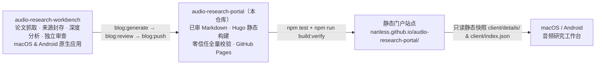

# 音频研究门户（Audio Research Portal）

简体中文 | [English](README.en.md)

> 面向语音、音乐与声学 AI 研究者的开源中文论文阅读门户与只读客户端数据底座，由 **[音频研究工作台（Audio Research Workbench）](https://github.com/nanless/audio-research-workbench)** 驱动构建与发布。

**在线访问**：<https://nanless.github.io/audio-research-portal/>  
**原生应用（macOS / Android）**：[GitHub Releases](https://github.com/nanless/audio-research-workbench/releases) · **主引擎仓库**：[nanless/audio-research-workbench](https://github.com/nanless/audio-research-workbench)

---

## 快速入口

| 入口 | 在线地址 | 说明 |
|---|---|---|
| 每日研究日报 | <https://nanless.github.io/audio-research-portal/> | 每日精选 arXiv 与 HuggingFace 语音、音乐与声学 AI 论文 |
| 八大专题导航（SOTA Hubs） | <https://nanless.github.io/audio-research-portal/hubs/> | ASR、TTS、语音增强、音频大模型、音乐/MIR、空间音频、音频理解、音色转换 |
| 论文库与批量导出 | <https://nanless.github.io/audio-research-portal/papers/> | 九维多级筛选、同篇去重合并、导出 Markdown / CSV / BibTeX / RIS |
| 会议论文集 | <https://nanless.github.io/audio-research-portal/conferences/> | 按 CCF 第七版档次与官方会期浏览国际顶会总览及单篇精读 |
| 九维研究方向 | <https://nanless.github.io/audio-research-portal/tags/> | 400 项受控词表九大分面多级分类树 |
| 每日归档 / 全站搜索 | [归档](https://nanless.github.io/audio-research-portal/archives/) · [搜索](https://nanless.github.io/audio-research-portal/search/) | 历期日报按月归档与中英文模糊检索（站内可随时按 `⌘K` / `/`） |
| 读者指南与研究资源 | [使用方法](https://nanless.github.io/audio-research-portal/about/) · [资源指南](https://nanless.github.io/audio-research-portal/links/) | 选文、核源、引用导出及外部 AI agent 协作路线 |
| 原生客户端下载 | [macOS / Android Releases](https://github.com/nanless/audio-research-workbench/releases) | 离线同步门户静态数据包，提供双端原生精读与研究管理 |

---

## 当前收录规模与覆盖（截至 2026-11-27）

- **9,402 篇已发布文章**（覆盖 **8,673+ 篇**按官方身份去重核验的独立论文，以及每日研究日报与顶会总览）。
- **8 个音频 SOTA 专题导航**（`/hubs/`）：自动聚合高分精选（Top 20）、最新收录、开源代码与试听 Demo 精选、高频方法/评测设定、近 6 个月收录趋势，以及 **15 个重点来源与顶会分布**（`arXiv`、`ICASSP`、`Interspeech`、`NeurIPS`、`ICLR`、`ICML`、`ACL`、`EMNLP`、`ISMIR`、`DCASE`、`WASPAA`、`ASRU`、`SLT`、`CVPR`、`AAAI`）。
- **19 届已核验官方会期与 CCF 第七版评级的会议目录**（`data/conference-directory.json`），并实现 **6 端 58 键规范会议显示名对齐**（门户单篇页模板 `single.html`、论文库前端 `paper-library.js`、构建语料库 `research-corpus.js`，以及工作台仓库内的 macOS 原生 Swift、macOS WebView JS 与 Android Kotlin 保持逐键一致）。
- **400 项九维受控研究方向词表**：并列覆盖研究任务、研究方法、研究条件、信号、应用、研究重点、研究产物、科学主题与模型家族，历史快照按原始来源 SHA-256 只读保留。
- **全量 + 6 路精选 RSS 与三路径播客同步**：提供每日研究全量 RSS、6 路按评分与研究方向精选的单篇 RSS，并原生支持每日音频播客的三路径发布（播客 RSS、网页章节播放器与客户端 JSON 订阅源）。

---

## 双仓库架构

本系统采用严格解耦的双仓库分工，确保分析流水线、原生客户端与静态门户各自边界清晰、可独立验证：



| 维度 | `nanless/audio-research-portal`（本仓库） | `nanless/audio-research-workbench` |
|---|---|---|
| 核心职责 | 已审页面存储、Hugo 站点构建、全站静态产物导出、零信任构建核验与 GitHub Pages 部署 | 论文抓取、官方 HTML/PDF 来源封存、深度精读与评分生成、独立发布审查、播客制作及 macOS / Android 原生应用源码 |
| 运行特性 | 100% 静态生成与纯本地离线校验，不调用 LLM API、不发起网络抓取 | 受控代理联网、多阶段分析与发布凭证门禁 |
| 历史兼容性 | 保留历史 Markdown 原字节；历史上使用 `/audio-paper-digest-blog/` 前缀的站内链接在构建渲染阶段自动归一化为 `/audio-research-portal/` | 统一向本仓库 `main` 推送精确受审差异 |

---

## 阅读体验与技术亮点（Studio Monograph 2.0）

- **Studio Monograph 2.0 学术精读排版**：双主题自动/手动切换（含 Giscus 评论区主题同步）、全站阅读进度条、顶部音频与复现规格速览卡、在线试听直达按钮、右侧八维分类型评分细项条与手机端浮动章节目录。
- **即时命令面板（`⌘K` / `/`）**：支持按论文解读、高分（≥8.0）、含开源代码、含在线试听、每日研究与会议专题即时分面筛选；构建时由 `scripts/build-pagefind.js` 按实际产物写入 `data-cmdk-pagefind-ready` 门控属性，在未构建 Pagefind 索引时平滑降级、零 404 请求。
- **论文配图查看器与数据表格工作台**：任意配图点击支持 1×–6× 缩放、拖拽平移与原色/深色反色切换；实验数据表支持按数值与单位智能排序、首列冻结及一键全屏对比。
- **编译期 KaTeX 公式渲染与容错治愈**：无任何外部 MathJax / jsdelivr CDN 依赖；`render_katex_formula.html` 内置两阶段渲染层容错（兼容历史 LaTeX / LaTeXML 写法并严格遵守 MathML 白名单），2026-11-26 起全部新文章强制零 `math-fallback` 回退。
- **预计算跨论文知识图谱**：构建阶段基于九维核验概念与研究背景预计算 `data/related-graph.json`，为单篇精读提供带推荐理由的跨论文关联导航（严格隔离暂缓分类与零向量条目）。
- **引用、笔记与播客工具**：支持一键复制已核实学术引用 / BibTeX / Obsidian YAML 笔记模板、下载 Citation JSON / BibTeX / RIS / Markdown 导读包；已发布播客期次的每日日报内置 0.75×–2.0× 倍速播放器与章节跳转。

---

## RSS 与播客订阅

| 订阅源 | 站内路径 | 说明 |
|---|---|---|
| 每日研究全量 RSS | [`index.xml`](https://nanless.github.io/audio-research-portal/index.xml) | 每期每日音频研究日报汇总（近 50 期） |
| 高分论文精选（≥8.0） | [`feeds/high-score.xml`](https://nanless.github.io/audio-research-portal/feeds/high-score.xml) | 站内高分单篇深度精读 |
| 语音识别（ASR）专题 | [`feeds/topic-asr.xml`](https://nanless.github.io/audio-research-portal/feeds/topic-asr.xml) | ASR、音视频识别、多说话人与流式识别 |
| 语音合成（TTS）专题 | [`feeds/topic-tts.xml`](https://nanless.github.io/audio-research-portal/feeds/topic-tts.xml) | TTS、零样本声音克隆、韵律控制与播客生成 |
| 语音增强与分离专题 | [`feeds/topic-enhancement.xml`](https://nanless.github.io/audio-research-portal/feeds/topic-enhancement.xml) | 降噪、去混响、回声消除、分离与修复 |
| 音乐生成与理解专题 | [`feeds/topic-music.xml`](https://nanless.github.io/audio-research-portal/feeds/topic-music.xml) | 音乐生成、歌声合成、MIR 与音乐源分离 |
| 音频大模型专题 | [`feeds/topic-audio-llm.xml`](https://nanless.github.io/audio-research-portal/feeds/topic-audio-llm.xml) | Audio/Speech LLM、全双工对话与神经编解码 |
| 每日音频播客（按期发布） | `feeds/podcast.xml` · `client/podcast/feed.json` | 随工作台播客发布同步生成播客 RSS、客户端 JSON 源与日报内置播放器 |

---

## 只读客户端数据底座与站内公开数据

以下前四项客户端契约在 `npm run build` 阶段静态生成并由 `npm run verify` 逐字节校验（协议与结构指纹登记于 [`data/paperdigest-protocols.json`](data/paperdigest-protocols.json)），供 macOS / Android 原生应用安全同步；播客客户端源随播客期次按需从工作台同步，跨论文知识图谱为门户构建产物并由 `npm run verify` 校验：

| 产物路径 | 协议 / 用途与生成时机 |
|---|---|
| `client/index.json`（及兼容入口 `index.json`） | `paper-search-index-manifest` — `npm run build` 生成并由 `verify` 校验的 SHA-256 绑定分片搜索索引（单片 ≤ 1 MiB） |
| `client/details/manifest.json` | `paper-desktop-manifest` / `paper-desktop-snapshot` / `paper-desktop-detail` — `npm run build` 生成并由 `verify` 校验的离线目录快照、tombstone 与净化单篇 HTML |
| `client/signals/resource-badges.json` | `paper-resource-badges-index` — `npm run build` 生成并由 `verify` 校验的开源代码、模型、数据集与试听 Demo 徽章索引 |
| `client/papers/<日期>/<论文标识>/*` | 单篇侧车资料（`citation.json`、`citation.bib`、`citation.ris`、`rethink-context.json`），`npm run build` 生成并由 `verify` 校验 |
| `client/podcast/feed.json` | `paper-daily-podcast-feed`（已登记于 `data/paperdigest-protocols.json`）— 仅在工作台执行播客发布（`--portal-repo`）时按需同步至 `static/client/podcast/feed.json`，MP3 仅限 GitHub Releases 白名单 HTTPS 地址 |
| `data/related-graph.json` | `paper-related-graph-v1` — 门户网页端预计算跨论文关联图谱（`npm run build` 生成并由 `verifyRelatedGraph` 校验，不属客户端协议登记族） |

---

## 本地开发与零信任构建验证

### 环境要求

- **Hugo**：`0.160.1`（extended，与 GitHub Pages CI 一致）
- **Node.js**：`>=20.18.1`（CI 使用 Node 22）
- **Pagefind**（可选）：安装后 `npm run build` 自动生成 `public/pagefind/` 全文索引并开启命令面板全文检索

### 常用命令（以 [`package.json`](package.json) 为准）

```bash
# 运行全部单元测试（91 个测试文件）与内容审计
npm test

# 仅运行全站 Markdown 内容审计（标签、arXiv 重复基线与站内论文链接）
npm run audit:content

# 执行完整静态构建（标签核验 → 选读封面 → 图谱与 8 大专题聚合 → Hugo → 搜索分片 → 客户端数据包 → Pagefind）
npm run build

# 对已有 public/ 产物执行零信任全量核验（RSS、索引分片、客户端快照、SOTA 专题、KaTeX 回退门禁、全站链接与锚点）
npm run verify

# 完整发布前门禁：内容审计 + 构建 + 产物核验（与 CI build 任务一致）
npm run build:verify
```

> **本地预览提示**：裸运行 `hugo` 不会执行前置的选读封面、知识图谱与 8 大专题聚合，也不会生成后置的搜索分片与客户端数据包。如需完整预览，请先执行 `npm run build` 再启动本地静态服务预览 `public/`。

CI 流水线（`.github/workflows/hugo.yaml`）在推送到 `main` 时并行运行独立的 `unit`（`npm test`）与 `build`（`npm run build:verify`）门禁，两者全部通过后才部署至 GitHub Pages；Pull Request 仅运行校验与构建，不上传或部署产物。

---

## 配套文档与勘误

- [门户页面生成、审查、推送与上线](docs/publishing.md)
- [每日论文选读封面机制](docs/daily-edition-cover.md)
- [论文页的客户端资料声明](docs/paper-page-client-sidecars.md)
- [研究方向浏览与多级筛选](docs/research-directions.md)

如发现题目、论文身份、数据、公式或链接存在错误，欢迎[提交勘误 Issue](https://github.com/nanless/audio-research-portal/issues/new)，并附上导读页面链接、官方论文地址与版本信息。
